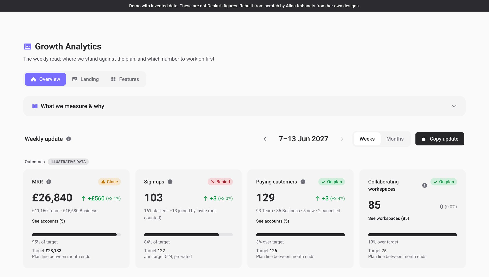

# Growth Analytics: a dashboard for the Monday read

The Overview tab of a growth dashboard I designed and built at Deaku, an early-access workspace for creators and their teams. It answers three questions every week: where do we stand against the plan, which number do we work on first, and did last week's changes move anything?

This repository is a **from-scratch rebuild on invented data**. The design is mine; the code here was written fresh for this demo, and every number is generated. Nothing comes from Deaku's codebase, database or figures.



- **Live demo:** [growth-dashboard-demo-two.vercel.app](https://growth-dashboard-demo-two.vercel.app)
- **Case study:** [alinakabanets.com/work/deaku-kpi-tree](https://alinakabanets.com/work/deaku-kpi-tree), on how the six numbers were chosen, from a revenue goal down to design metrics, and why this screen exists

## The problem it solves

Before the dashboard, the numbers lived in documents and spreadsheets. Each was pulled by hand from a different source, and two queries for the same metric could disagree depending on who ran them. When the landing page or sign-up changed, nobody could say whether it had worked, and a spike from a webinar looked like a product win.

The goal was one screen the founders and the team open every Monday, built on numbers everyone agrees on.

## What's on the page

| Section | What it shows |
| --- | --- |
| **Outcome tiles** | Revenue (MRR), sign-ups, paying customers and collaborating workspaces, each against its target, with a status and the change from the period before. Tiles open the exact accounts or workspaces counted. |
| **The six numbers** | The funnel drivers in order: visits, sign-up start, mobile sign-up, activation in 48 hours, retention at 4 weeks, free to paid. Collapse points are marked, and one driver is flagged **Work on first**. |
| **Revenue staircase** | The plan's month-end steps to the year's revenue goal, and where each month actually ended. |
| **Trends** | Any metric over time: actual as a solid line, target dashed. Webinars, launches and mail-outs are markers, so a spike explains itself. |
| **Copy update** | Turns the same numbers into text for the team chat. |

Things to try: switch between **Weeks** and **Months**, step back through periods, hover the info icons and the staircase, pick a metric in Trends, and copy the update.

## Design decisions

- **Results and levers take different shapes.** Outcomes are tiles; drivers are a ladder table in funnel order. Both read from the same rows, so they can never disagree.
- **Density without noise.** Mostly black, white and grey. Colour appears only when a number is behind or close to target.
- **Every number can be traced.** Hover panels show what a figure is made of, and tiles list the accounts behind it.
- **Show the gap, don't invent the number.** When a figure can't be read, the page says why. A missing week is a gap in the chart, never a zero. The demo has one on purpose: a week in January when website analytics went missing.
- **It feeds the ritual.** "Copy update" doesn't replace the team chat; it makes posting to it a one-click job.

## How it's built

```
lib/demo/        seeded generator → daily rows, accounts, weekly collaboration
      │
lib/periods.ts   which days belong to a week or a month
lib/metrics.ts   one query layer: readPeriod() returns every number for a period
      │
components/      tiles, ladder table, staircase, trends: all read the same result
```

- **One query layer.** `readPeriod()` returns all ten readings for a week or month: value, previous value, target and status. Every section renders from that one result, which is why the tiles, table, staircase and trends always agree.
- **Period rules as pure functions, with tests.**
  - Weeks are complete UK weeks, Monday to Sunday.
  - A week belongs to the month its Thursday falls in, so it is never split or counted twice.
  - The month in progress is read to the last day with data.
- **Status thresholds.** Exceeded at 125% of target or more, on plan from 100%, close from 90%, behind below that. A missing reading is "no data", never zero.
- **Targets come from the plan.** Visit and sign-up targets are worked back from the plan's paying-customer steps, so every target traces to the revenue goal.
- **Static by default.** Every number is computed at build time from a fixed seed (`DEMO_SEED`), so each build is identical and the page is served as static HTML.

## Stack

Next.js 16 (App Router) · React 19 · TypeScript · Tailwind CSS v4 · Phosphor icons · Vitest

## Run it locally

```bash
npm install
npm run dev        # http://localhost:3000
npm test           # period rules, status thresholds, demo data
npm run lint && npm run build
```

## Project structure

```
app/                 page and layout (static)
components/          dashboard sections and shared UI: pills, tooltips, segmented control
lib/demo/            the invented company: plan, prices, events, and the seeded generator
lib/metrics.ts       query layer, status rule, staircase and "work on first"
lib/periods.ts       weeks, months and the Thursday rule
lib/definitions.ts   what each metric means and how it's read
lib/update-text.ts   the "Copy update" text
lib/brand.ts         brand name and disclaimer in one place
tests/               Vitest specs
```

## About the data

Everything is invented: the plan, prices, targets, accounts ("Workspace 001" and so on), events and every figure. The scale and the shape of the trends were chosen to differ from the real product, and a banner on the page says so. The demo is published with the founders' permission.

---

Designed and built by [Alina Kabanets](https://alinakabanets.com).
